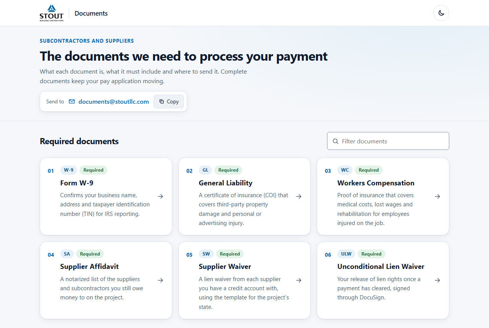
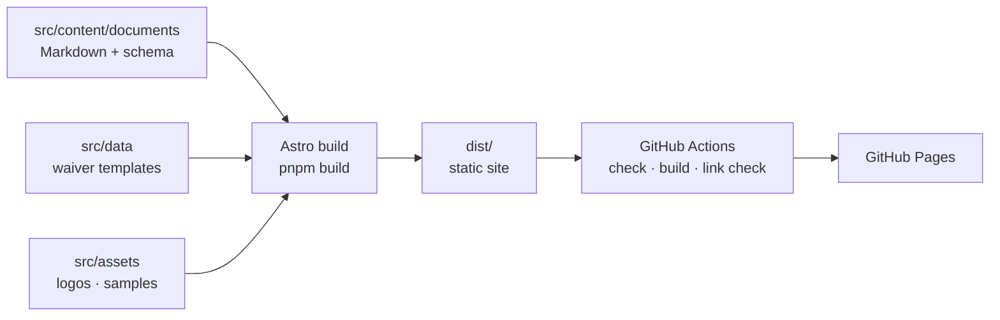

<p align="center">
  <picture>
    <source media="(prefers-color-scheme: dark)" srcset="src/assets/brand/stout-logo-white.png">
    
  </picture>
</p>

<p align="center">
  Documentation portal for Stout subcontractors and suppliers.<br>
  The documents Stout needs to process a payment: what each one is, what it must include and
  where to send it.
</p>

<p align="center">
  <a href="#features">Features</a> ·
  <a href="#structure">Structure</a> ·
  <a href="#how-it-works">How it works</a> ·
  <a href="#getting-started">Getting started</a> ·
  <a href="#usage">Usage</a> ·
  <a href="#troubleshooting">Troubleshooting</a> ·
  <a href="#contributing">Contributing</a> ·
  <a href="#security">Security</a> ·
  <a href="#license">License</a>
</p>

<p align="center">
  <a href="https://github.com/M1gu3l4ngel/stout-documents-portal/actions/workflows/ci.yml"></a>
  
  
  
  <a href="LICENSE"></a>
</p>

---

Subcontractors and suppliers send Stout a set of documents before they get paid: tax forms,
insurance certificates, affidavits and lien waivers. This site explains each one in plain
language, shows a sample with the fields that matter, and links the templates to download. It is
live at <https://m1gu3l4ngel.github.io/stout-documents-portal/>.

<picture>
  <source media="(prefers-color-scheme: dark)" srcset="docs/assets/preview-dark.png">
  
</picture>

## Features

- **Six required documents:** Form W-9, General Liability, Workers Compensation, Supplier
  Affidavit, Supplier Waiver and Unconditional Lien Waiver, each with its own page.
- **What it must include:** a checklist per document, plus the notice that most often delays a
  payment.
- **Where to send it:** the submission email on every page, with a copy button.
- **Samples and templates:** annotated sample images, the official IRS Form W-9 and supplier
  waiver templates for each state.
- **Filter:** find a document by name or abbreviation from the home page.
- **Light and dark themes:** follows the system, and remembers the visitor's choice.
- **Old links keep working:** the URLs of the previous site (`pages/w9.html` and the rest)
  redirect to their new pages.

## Structure

| Folder                   | Contents                                                                 |
| ------------------------ | ------------------------------------------------------------------------ |
| `src/content/documents/` | One Markdown file per document; the schema is in `src/content.config.ts` |
| `src/data/`              | Supplier waiver templates per state                                      |
| `src/pages/`             | Home page, document page template and 404 page                           |
| `src/components/`        | Header, footer, cards, theme toggle, icons and the waiver table          |
| `src/layouts/`           | The single page layout                                                   |
| `src/styles/`            | Global CSS with the light and dark color tokens                          |
| `src/assets/`            | Stout logos and sample images, optimized at build time                   |
| `public/`                | Favicon and redirects from the previous site's URLs                      |
| `scripts/`               | Internal link checker for the built site                                 |

## How it works

Astro reads the Markdown documents and the waiver data, checks them against their schema, and
builds a static site. On every push to `main`, GitHub Actions checks and builds it, then deploys
`dist/` to GitHub Pages.



## Getting started

### Requirements

| Tool    | Version                                       | Windows                            | macOS                  | Linux                                                    |
| ------- | --------------------------------------------- | ---------------------------------- | ---------------------- | -------------------------------------------------------- |
| Node.js | The one in `engines.node` of `package.json`   | `winget install OpenJS.NodeJS.LTS` | `brew install node@24` | [nodejs.org/en/download](https://nodejs.org/en/download) |
| pnpm    | The one in `packageManager` of `package.json` | `npm install -g pnpm`              | `npm install -g pnpm`  | `npm install -g pnpm`                                    |
| Git     | Any recent version                            | `winget install Git.Git`           | `brew install git`     | Your distribution's package manager                      |

### Install

From the folder where you keep your projects, as a normal user:

```bash
git clone https://github.com/M1gu3l4ngel/stout-documents-portal.git
cd stout-documents-portal
pnpm install
pnpm dev
```

Check that it worked: open <http://localhost:4321/stout-documents-portal/> and the home page
shows the six documents.

## Usage

All commands run from the repository root, as a normal user.

| Command             | What it does                                       |
| ------------------- | -------------------------------------------------- |
| `pnpm dev`          | Starts a local server that reloads on every change |
| `pnpm check`        | Checks types and the content schema                |
| `pnpm format:check` | Checks formatting with Prettier                    |
| `pnpm build`        | Builds the site into `dist/`                       |
| `pnpm check:links`  | Checks every internal link in `dist/`              |
| `pnpm preview`      | Serves `dist/` to review the built site            |

### Edit a document

Open its file in `src/content/documents/`. The front matter holds the title, the summary, the
submission email, the "What it must include" list, the notice, the sample image and the
downloads; the Markdown below it is the page text. `pnpm check` reports any field that does not
match the schema.

### Add or change a waiver template

Edit `src/data/waiver-templates.ts`. Each state lists its four templates (conditional or
unconditional, progress or final) by their Google Drive file ID.

### Publish a change

Merge it into `main` through a pull request. CI checks it, builds it and deploys it to GitHub
Pages; the site updates a minute or two after the run ends.

## Troubleshooting

| Symptom                                                 | Cause                                                 | Fix                                                             |
| ------------------------------------------------------- | ----------------------------------------------------- | --------------------------------------------------------------- |
| `localhost:4321` shows a 404 page                       | The site lives under the repository path              | Open `http://localhost:4321/stout-documents-portal/`            |
| `pnpm install` fails with `MINIMUM_RELEASE_AGE`         | A dependency was published less than two weeks ago    | Pin the previous version in `package.json`, then `pnpm install` |
| `pnpm check` fails on a document                        | A front matter field is missing or has the wrong type | Fix the field the error names, in the file it names             |
| The site did not update after a merge                   | The CI run failed, so nothing was deployed            | Open the run in the Actions tab and fix the failing step        |
| `pnpm dev` shows `ENOENT ... astro\assets\endpoint\dev` | `node_modules` was reinstalled while the server ran   | Stop the server with `Ctrl+C` and run `pnpm dev` again          |

## Contributing

The flow, the checks and the commit format are in [CONTRIBUTING.md](CONTRIBUTING.md), and
everyone who takes part follows the [code of conduct](CODE_OF_CONDUCT.md).

## Security

A vulnerability is reported privately, never in a public issue: [SECURITY.md](SECURITY.md).

## License

Proprietary. Copyright Stout Building Contractors, all rights reserved: [LICENSE](LICENSE).
